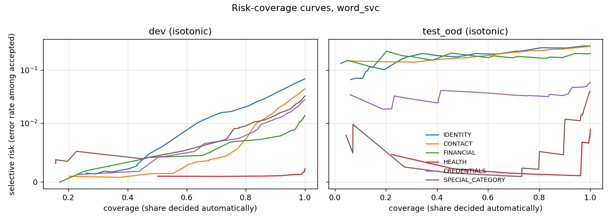

# sensclf -- sensitive-document classification with calibrated probabilities, abstention and conformal guarantees

**Try it in your browser:** [live demo on Hugging Face](https://huggingface.co/spaces/haitam1255/sensitivity-classifier-demo)
(the selected model, its certified abstention thresholds and conformal sets, run in the page).

An independent research project. Given a whole document, predict which of six categories of
personal data it contains (IDENTITY, CONTACT, FINANCIAL, HEALTH, CREDENTIALS and the GDPR
Article 9 SPECIAL_CATEGORY). Then ask whether the predicted probabilities can be trusted:

| question | milestone | answer in |
|---|---|---|
| RQ1. How well do simple, transparent text models detect each category? | M2 | [docs/results.md](docs/results.md) |
| RQ2. Do they read the content, or only the document's domain? | M2 | [docs/results.md](docs/results.md) |
| RQ3. Are their probabilities calibrated, and does calibration survive domain shift? | M3 | [docs/results-uncertainty.md](docs/results-uncertainty.md) |
| RQ4. With a certified target error rate, how many documents can be decided without a human? | M4 | [docs/results-uncertainty.md](docs/results-uncertainty.md) |
| RQ5. Do conformal prediction sets keep their coverage guarantee in-domain and under shift? | M5 | [docs/results-uncertainty.md](docs/results-uncertainty.md) |

Every number in the docs is written by a script from committed result files; nothing is typed
by hand, and generated comparative sentences are re-checked against their own numbers by a
test.

## Main findings

All data are **synthetic** (see [Data](#data)), so the numbers describe these benchmarks, not
real-world documents. Three evaluation sets: **dev** (in-domain), **test_shift** (same
generator, other locale and mostly unseen domains) and **test_ood** (a different generator).

* **Detection (RQ1).** TF-IDF + linear SVM reaches macro PR-AUC 0.981 on dev and 0.979 on
  test_shift, but only 0.589 on test_ood. Shift in locale and domain barely matters; a change of
  generator does.
* **Shortcuts (RQ2).** A model that sees only the document's domain label reaches 0.588 on dev
  but 0.364 under shift, while the text models lose 0.002-0.003. The text models do not live
  on the domain shortcut. Most of their top features are field labels ("blood type", "api key").
* **Calibration (RQ3).** Isotonic calibration, fitted on a held-out half of the calibration
  split, cuts the expected calibration error of the SVM from 0.012 (temperature) to 0.005 on dev
  and from 0.010 to 0.006 on test_shift. On test_ood, every calibrator is badly off (ECE
  0.12-0.15 across the three models), and the most flexible one (isotonic) is the worst: calibration learnt in-domain
  does not transfer.
* **Abstention (RQ4).** Thresholds certified on held-out data (risk <= r* with probability
  >= 95%) were respected on dev and test_shift for all 17 certified thresholds. On test_ood they
  were violated for all 12 that could be checked (e.g. CONTACT at r* = 1%: 15.8% errors).
  Requiring all six categories to be accepted leaves 37% of dev documents decided
  automatically at r* = 2%.
* **Conformal sets (RQ5).** With one quantile per true class (Mondrian), coverage reaches the
  target in-domain in 18 of 18 cases (alpha = 1%, 5%, 10%), sensitive documents included. Under
  shift it falls short in 5 of 18 cases on test_shift and 12 of 12 on test_ood (down to ~50% at
  a 90% target).

So the guarantees hold where their assumption (exchangeability) holds, and this project
measures how they fail when it does not. Details, intervals and figures are in the two
results documents. The methods are explained in [docs/theory](docs/theory).



## Data

Two public, fully synthetic datasets: NVIDIA **Nemotron-PII** (CC BY 4.0) and **Gretel
synthetic PII finance multilingual** (Apache 2.0), used through our own public library
[privgate](https://github.com/echchakarhaitam-cyber/llm-privacy-gateway), pinned to a commit.
No data are redistributed: raw and processed files stay out of the repository. Only hashes,
statistics and results are committed. The task, the category mapping and all judgement calls
are fixed in [docs/TASK.md](docs/TASK.md), and the data, licences and splits are described in
[docs/DATA.md](docs/DATA.md). Splits are group-aware: two renderings of the same synthetic
person never end up on both sides of a split, and the calibration split is used for nothing
else.

## Reproduce

Python >= 3.10.

```
python -m venv .venv
.venv/bin/python -m pip install -e ".[dev,ml,plots]"     # Windows: .venv\Scripts\python.exe
.venv/bin/python -m pytest -q                            # unit tests (no data needed)
.venv/bin/python -m ruff check .
```

The full pipeline needs the raw dataset files (see docs/DATA.md for the exact revisions and
`SENSCLF_RAW_DIR`):

```
python scripts/build_sets.py            # processed sets + manifest
python scripts/data_stats.py
python scripts/m2_train.py              # models, hyper-parameters chosen on dev
python scripts/m2_evaluate.py
python scripts/m2_shortcuts.py
python scripts/make_results.py          # docs/results.md
python scripts/m3_calibrate.py          # calibration (RQ3)
python scripts/m4_m5_uncertainty.py     # abstention and conformal sets (RQ4, RQ5)
python scripts/m3_m4_figures.py
python scripts/make_uncertainty_results.py   # docs/results-uncertainty.md
pytest -q -m data                       # integration tests on the real data
```

## Repository layout

```
src/sensclf/   labels, splits, models, metrics with cluster bootstrap, calibration,
               selective prediction, conformal prediction, report generation
scripts/       one script per step; each writes results/<milestone>/*.json
results/       committed result files (predictions and models are not committed)
docs/          task, data, generated results, theory notes, figures
tests/         unit tests (pytest), integration tests marked `data`
```

## Limitations

Synthetic data with generator-specific templates; labels derived from annotated spans; linear
bag-of-n-gram models only; guarantees that are marginal and assume exchangeability; no
categories for online identifiers. See the *Threats to validity* section of
[docs/results.md](docs/results.md) and the notes in
[docs/results-uncertainty.md](docs/results-uncertainty.md).

## Licence and citation

Code: MIT ([LICENSE](LICENSE)). Data remain under their own licences. To cite, see
[CITATION.cff](CITATION.cff).
