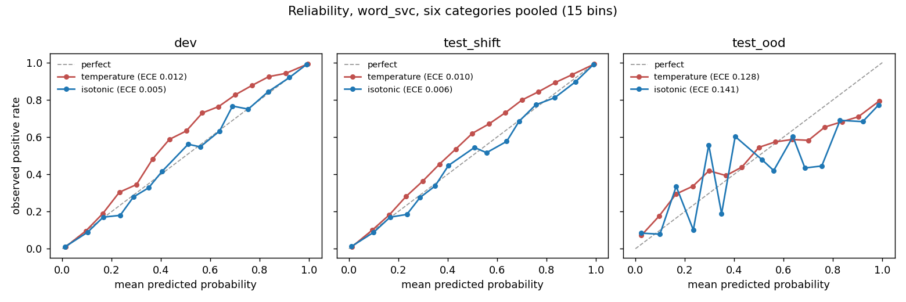
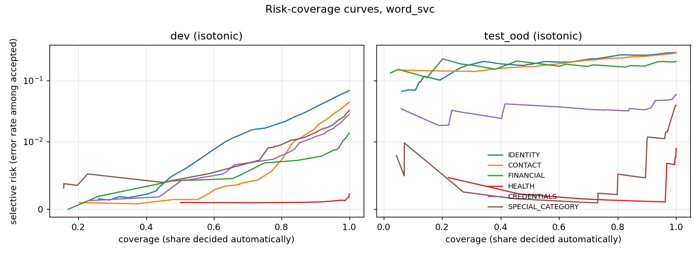

# Results -- calibration, abstention and conformal sets (RQ3-RQ5)

Generated by `scripts/make_uncertainty_results.py` from `results/m3`, `results/m4` and `results/m5`. Do not edit by hand. Methods: [theory note](theory/02-calibration-abstention-conformal.md).

## RQ3 -- Are the probabilities calibrated, and does calibration survive shift?

Calibrators are fitted on cal_fit (5024 documents) only; the calibrator of each model is selected by **lowest macro brier on dev**. Macro values over the six categories; 95% cluster-bootstrap intervals by group (1000 resamples). ECE uses 15 equal-width bins.

### `char_lr` (selected: **isotonic**)

| method | ECE dev | ECE test_shift | ECE test_ood | Brier dev | Brier test_shift | Brier test_ood |
|---|---:|---:|---:|---:|---:|---:|
| raw | 0.0223 | 0.0186 | 0.1114 | 0.0310 | 0.0362 | 0.1438 |
| temperature | 0.0124 | 0.0117 | 0.1201 | 0.0302 | 0.0356 | 0.1480 |
| platt | 0.0093 | 0.0080 | 0.1256 | 0.0293 | 0.0350 | 0.1526 |
| isotonic | 0.0063 | 0.0077 | 0.1341 | 0.0293 | 0.0351 | 0.1578 |

- dev (in-domain): `char_lr+isotonic` has a lower ECE than `char_lr+raw` (0.006 vs 0.022).
- test_shift (us -> intl): `char_lr+isotonic` has a lower ECE than `char_lr+raw` (0.008 vs 0.019).
- test_ood (Gretel): `char_lr+isotonic` has a higher ECE than `char_lr+raw` (0.134 vs 0.111).

### `word_lr` (selected: **isotonic**)

| method | ECE dev | ECE test_shift | ECE test_ood | Brier dev | Brier test_shift | Brier test_ood |
|---|---:|---:|---:|---:|---:|---:|
| raw | 0.0241 | 0.0210 | 0.1236 | 0.0304 | 0.0338 | 0.1557 |
| temperature | 0.0144 | 0.0120 | 0.1328 | 0.0296 | 0.0330 | 0.1608 |
| platt | 0.0088 | 0.0076 | 0.1403 | 0.0279 | 0.0321 | 0.1647 |
| isotonic | 0.0060 | 0.0071 | 0.1485 | 0.0279 | 0.0323 | 0.1718 |

- dev (in-domain): `word_lr+isotonic` has a lower ECE than `word_lr+raw` (0.006 vs 0.024).
- test_shift (us -> intl): `word_lr+isotonic` has a lower ECE than `word_lr+raw` (0.007 vs 0.021).
- test_ood (Gretel): `word_lr+isotonic` has a higher ECE than `word_lr+raw` (0.148 vs 0.124).

### `word_svc` (selected: **isotonic**)

| method | ECE dev | ECE test_shift | ECE test_ood | Brier dev | Brier test_shift | Brier test_ood |
|---|---:|---:|---:|---:|---:|---:|
| temperature | 0.0119 | 0.0097 | 0.1279 | 0.0266 | 0.0303 | 0.1575 |
| platt | 0.0096 | 0.0073 | 0.1330 | 0.0256 | 0.0298 | 0.1596 |
| isotonic | 0.0054 | 0.0062 | 0.1405 | 0.0254 | 0.0300 | 0.1655 |

- dev (in-domain): `word_svc+isotonic` has a lower ECE than `word_svc+temperature` (0.005 vs 0.012).
- test_shift (us -> intl): `word_svc+isotonic` has a lower ECE than `word_svc+temperature` (0.006 vs 0.010).
- test_ood (Gretel): `word_svc+isotonic` has a higher ECE than `word_svc+temperature` (0.141 vs 0.128).

Note on intervals: ECE is biased upwards in small resamples (empty or sparse bins add noise that never cancels), so the bootstrap distribution of ECE can sit entirely above the point value; the intervals of the Brier score and log loss do not have this problem and are the ones to read for uncertainty. Full intervals are in `results/m3/calibration.json`.

## RQ4 -- Abstention: how much can be decided automatically at a target risk?

Model: `word_svc` + isotonic calibration. Per category, the decision is p >= 0.5 and the confidence max(p, 1 - p). Thresholds are certified on cal_test (5002 documents) so that the selective risk is <= r* with probability >= 0.95 under exchangeability (20 candidate coverages, Bonferroni, exact binomial test).

### Risk-coverage summary (AURC; lower is better)

| category | AURC dev | AURC test_shift | AURC test_ood | oracle dev | oracle test_shift | oracle test_ood |
|---|---:|---:|---:|---:|---:|---:|
| IDENTITY | 0.0135 | 0.0200 | 0.1956 | 0.0025 | 0.0043 | 0.0467 |
| CONTACT | 0.0059 | 0.0055 | 0.1906 | 0.0010 | 0.0008 | 0.0452 |
| FINANCIAL | 0.0044 | 0.0057 | 0.1756 | 0.0001 | 0.0002 | 0.0235 |
| HEALTH | 0.0010 | 0.0018 | 0.0025 | 0.0000 | 0.0000 | 0.0000 |
| CREDENTIALS | 0.0057 | 0.0082 | 0.0317 | 0.0004 | 0.0007 | 0.0018 |
| SPECIAL_CATEGORY | 0.0074 | 0.0084 | 0.0041 | 0.0005 | 0.0009 | 0.0008 |

### Certified thresholds: coverage / achieved risk

A cell shows coverage, achieved selective risk and, in brackets, the 95% bootstrap interval of the risk; **bold** marks a risk above the target.

#### r* = 1.0%

| category | certified on cal_test | dev | test_shift | test_ood |
|---|---|---|---|---|
| IDENTITY | yes, coverage 31.1% | 32.1% / 0.2% [0.001, 0.003] | 34.0% / 0.3% [0.002, 0.003] | 10.9% / **7.0%** [0.043, 0.099] |
| CONTACT | yes, coverage 62.5% | 63.5% / 0.3% [0.002, 0.005] | 64.3% / 0.3% [0.003, 0.004] | 39.1% / **15.8%** [0.138, 0.180] |
| FINANCIAL | yes, coverage 72.8% | 75.0% / 0.7% [0.005, 0.009] | 75.7% / 0.7% [0.006, 0.008] | 38.2% / **15.5%** [0.134, 0.174] |
| HEALTH | yes, coverage 100.0% | 100.0% / 0.2% [0.001, 0.003] | 100.0% / 0.5% [0.005, 0.006] | 99.9% / 0.8% [0.005, 0.012] |
| CREDENTIALS | yes, coverage 42.5% | 43.8% / 0.2% [0.001, 0.003] | 41.1% / 0.4% [0.004, 0.005] | 22.2% / **1.9%** [0.009, 0.029] |
| SPECIAL_CATEGORY | no (abstain on everything) | coverage 0 | coverage 0 | coverage 0 |

#### r* = 2.0%

| category | certified on cal_test | dev | test_shift | test_ood |
|---|---|---|---|---|
| IDENTITY | yes, coverage 50.3% | 51.9% / 0.6% [0.004, 0.008] | 49.3% / 0.8% [0.007, 0.008] | 19.2% / **10.3%** [0.077, 0.127] |
| CONTACT | yes, coverage 83.2% | 83.0% / 1.0% [0.008, 0.012] | 84.4% / 0.9% [0.009, 0.010] | 59.8% / **19.0%** [0.172, 0.210] |
| FINANCIAL | yes, coverage 100.0% | 100.0% / 1.4% [0.012, 0.016] | 100.0% / 1.7% [0.017, 0.018] | 100.0% / **20.8%** [0.194, 0.222] |
| HEALTH | yes, coverage 100.0% | 100.0% / 0.2% [0.001, 0.003] | 100.0% / 0.5% [0.005, 0.006] | 99.9% / 0.8% [0.005, 0.012] |
| CREDENTIALS | yes, coverage 91.9% | 92.4% / 1.3% [0.011, 0.016] | 91.3% / 1.7% [0.016, 0.018] | 89.2% / **3.3%** [0.026, 0.040] |
| SPECIAL_CATEGORY | yes, coverage 86.5% | 85.8% / 1.1% [0.009, 0.014] | 84.7% / 1.3% [0.012, 0.013] | 80.0% / 0.4% [0.002, 0.007] |

#### r* = 5.0%

| category | certified on cal_test | dev | test_shift | test_ood |
|---|---|---|---|---|
| IDENTITY | yes, coverage 85.8% | 86.9% / 3.0% [0.026, 0.034] | 83.4% / 4.1% [0.039, 0.042] | 64.0% / **20.4%** [0.186, 0.223] |
| CONTACT | yes, coverage 95.9% | 96.1% / 3.1% [0.027, 0.034] | 96.7% / 2.8% [0.027, 0.029] | 88.7% / **25.1%** [0.233, 0.266] |
| FINANCIAL | yes, coverage 100.0% | 100.0% / 1.4% [0.012, 0.016] | 100.0% / 1.7% [0.017, 0.018] | 100.0% / **20.8%** [0.194, 0.222] |
| HEALTH | yes, coverage 100.0% | 100.0% / 0.2% [0.001, 0.003] | 100.0% / 0.5% [0.005, 0.006] | 99.9% / 0.8% [0.005, 0.012] |
| CREDENTIALS | yes, coverage 100.0% | 100.0% / 2.8% [0.025, 0.031] | 100.0% / 3.6% [0.035, 0.037] | 100.0% / **5.9%** [0.051, 0.068] |
| SPECIAL_CATEGORY | yes, coverage 100.0% | 100.0% / 3.2% [0.029, 0.036] | 100.0% / 4.1% [0.040, 0.042] | 100.0% / 3.9% [0.032, 0.046] |

Counted from the tables above:

- dev (in-domain): the achieved risk exceeds the target for 0 of 17 certified thresholds.
- test_shift (us -> intl): the achieved risk exceeds the target for 0 of 17 certified thresholds.
- test_ood (Gretel): the achieved risk exceeds the target for 12 of 17 certified thresholds.
- Not certifiable on cal_test (too few accepted documents with few enough errors): SPECIAL_CATEGORY at r* = 1.0%.

### Whole documents

A document is decided automatically only if all six categories are accepted; its error rate counts a document as wrong if any accepted category is wrong. The per-category guarantees do not add up to a document-level one (no union bound is applied here), which the error rates below make visible.

| r* | coverage dev | coverage test_shift | coverage test_ood | doc error dev | doc error test_shift | doc error test_ood |
|---|---:|---:|---:|---:|---:|---:|
| 1.0% | 0.0% | 0.0% | 0.0% | n/a | n/a | n/a |
| 2.0% | 37.4% | 35.3% | 11.0% | 3.9% | 5.2% | 39.4% |
| 5.0% | 83.5% | 80.6% | 57.4% | 12.1% | 14.4% | 54.2% |

## RQ5 -- Conformal prediction sets: is the coverage guarantee met?

Model: `word_svc` + isotonic. Quantiles computed on 2501 cal_test documents (one per group). Coverage is the share of documents whose true label is in the set; *both* is the share of sets {0, 1} (the model abstains), *empty* the share of empty sets. Under exchangeability the coverage is at least 1 - alpha; the upper bound 1 - alpha + 1/(n + 1) holds only without ties in the scores, and isotonic calibration produces many ties, so coverage above it is expected and not an error.

### Marginal

#### alpha = 1.0% (target coverage 99.0%)

| category | coverage dev | coverage test_shift | coverage test_ood | coverage y=1 dev | both dev | empty dev |
|---|---:|---:|---:|---:|---:|---:|
| IDENTITY | 99.4% | 99.2% | **95.8%** | 98.9% | 36.7% | 0.0% |
| CONTACT | 99.4% | 99.4% | **89.6%** | 99.7% | 19.7% | 0.0% |
| FINANCIAL | 99.0% | **98.8%** | **85.1%** | 97.3% | 1.8% | 0.0% |
| HEALTH | 99.3% | **97.8%** | **96.2%** | 99.0% | 0.0% | 0.5% |
| CREDENTIALS | 99.4% | 99.3% | **97.8%** | 98.4% | 22.5% | 0.0% |
| SPECIAL_CATEGORY | **98.8%** | **98.7%** | 99.6% | 95.5% | 10.3% | 0.0% |

Joint 6-label sets (alpha / 6 per category): dev joint coverage 99.4%, all six decided 1.5%; test_shift joint coverage 99.3%, all six decided 1.5%; test_ood joint coverage 93.3%, all six decided 0.0%.

#### alpha = 5.0% (target coverage 95.0%)

| category | coverage dev | coverage test_shift | coverage test_ood | coverage y=1 dev | both dev | empty dev |
|---|---:|---:|---:|---:|---:|---:|
| IDENTITY | 95.7% | **94.3%** | **78.5%** | 93.2% | 6.4% | 0.0% |
| CONTACT | 95.8% | 96.3% | **72.8%** | 97.5% | 0.6% | 0.0% |
| FINANCIAL | 96.1% | 95.4% | **61.1%** | 93.7% | 0.0% | 3.0% |
| HEALTH | 97.3% | **94.9%** | **91.4%** | 90.0% | 0.0% | 2.6% |
| CREDENTIALS | 96.5% | 95.7% | **93.7%** | 86.9% | 0.0% | 0.9% |
| SPECIAL_CATEGORY | 95.6% | **94.7%** | 95.5% | 86.6% | 0.0% | 2.0% |

Joint 6-label sets (alpha / 6 per category): dev joint coverage 96.8%, all six decided 25.9%; test_shift joint coverage 96.1%, all six decided 23.9%; test_ood joint coverage 76.9%, all six decided 4.0%.

#### alpha = 10.0% (target coverage 90.0%)

| category | coverage dev | coverage test_shift | coverage test_ood | coverage y=1 dev | both dev | empty dev |
|---|---:|---:|---:|---:|---:|---:|
| IDENTITY | 91.3% | **88.8%** | **66.8%** | 90.2% | 0.0% | 3.2% |
| CONTACT | 91.2% | 92.1% | **62.0%** | 93.1% | 0.0% | 6.7% |
| FINANCIAL | 91.0% | 91.0% | **49.7%** | 85.2% | 0.0% | 8.2% |
| HEALTH | 91.7% | **88.8%** | **76.8%** | 90.0% | 0.0% | 8.2% |
| CREDENTIALS | 91.2% | **89.7%** | **86.3%** | 76.1% | 0.0% | 7.6% |
| SPECIAL_CATEGORY | 90.4% | **89.1%** | **89.1%** | 72.9% | 0.0% | 8.1% |

Joint 6-label sets (alpha / 6 per category): dev joint coverage 92.3%, all six decided 55.3%; test_shift joint coverage 90.2%, all six decided 51.0%; test_ood joint coverage 57.5%, all six decided 19.3%.

### Mondrian

#### alpha = 1.0% (target coverage 99.0%)

| category | coverage dev | coverage test_shift | coverage test_ood | coverage y=1 dev | both dev | empty dev |
|---|---:|---:|---:|---:|---:|---:|
| IDENTITY | 99.5% | 99.4% | **97.5%** | 99.6% | 44.3% | 0.0% |
| CONTACT | 99.6% | 99.6% | **92.9%** | 99.7% | 28.2% | 0.0% |
| FINANCIAL | 99.3% | 99.0% | **83.4%** | 99.1% | 21.4% | 0.0% |
| HEALTH | 99.3% | **97.9%** | **96.2%** | 99.3% | 0.0% | 0.0% |
| CREDENTIALS | 99.3% | 99.1% | **96.4%** | 99.6% | 42.5% | 0.0% |
| SPECIAL_CATEGORY | 99.3% | **98.7%** | **98.5%** | 99.5% | 45.1% | 0.0% |

Joint 6-label sets (alpha / 6 per category): dev joint coverage 99.7%, all six decided 0.0%; test_shift joint coverage 99.5%, all six decided 0.0%; test_ood joint coverage 95.4%, all six decided 0.0%.

#### alpha = 5.0% (target coverage 95.0%)

| category | coverage dev | coverage test_shift | coverage test_ood | coverage y=1 dev | both dev | empty dev |
|---|---:|---:|---:|---:|---:|---:|
| IDENTITY | 96.9% | 95.9% | **85.9%** | 96.6% | 11.5% | 0.0% |
| CONTACT | 96.6% | 97.0% | **76.9%** | 97.0% | 3.0% | 0.0% |
| FINANCIAL | 96.1% | 95.5% | **59.7%** | 96.0% | 0.0% | 2.9% |
| HEALTH | 98.4% | 95.8% | **91.4%** | 99.0% | 0.0% | 1.5% |
| CREDENTIALS | 96.3% | 95.3% | **89.5%** | 97.0% | 7.4% | 0.0% |
| SPECIAL_CATEGORY | 95.3% | **93.9%** | **89.1%** | 95.2% | 1.6% | 0.0% |

Joint 6-label sets (alpha / 6 per category): dev joint coverage 97.0%, all six decided 11.5%; test_shift joint coverage 94.7%, all six decided 10.5%; test_ood joint coverage 70.7%, all six decided 0.8%.

#### alpha = 10.0% (target coverage 90.0%)

| category | coverage dev | coverage test_shift | coverage test_ood | coverage y=1 dev | both dev | empty dev |
|---|---:|---:|---:|---:|---:|---:|
| IDENTITY | 91.3% | **88.8%** | **66.8%** | 90.2% | 0.0% | 3.2% |
| CONTACT | 92.4% | 93.4% | **65.2%** | 93.1% | 0.0% | 4.9% |
| FINANCIAL | 92.6% | 92.4% | **50.6%** | 90.8% | 0.0% | 6.6% |
| HEALTH | 91.7% | **88.8%** | **76.8%** | 90.0% | 0.0% | 8.2% |
| CREDENTIALS | 92.1% | 90.1% | **82.0%** | 92.5% | 0.0% | 5.4% |
| SPECIAL_CATEGORY | 92.3% | 91.0% | **85.2%** | 90.6% | 0.0% | 5.5% |

Joint 6-label sets (alpha / 6 per category): dev joint coverage 94.5%, all six decided 27.1%; test_shift joint coverage 91.9%, all six decided 24.6%; test_ood joint coverage 58.7%, all six decided 3.0%.

**Bold** marks a coverage below the target. Counted:

- marginal, dev (in-domain): 1 of 18 cells below target (SPECIAL_CATEGORY at alpha 1.0%).
- marginal, test_shift (us -> intl): 10 of 18 cells below target (FINANCIAL at alpha 1.0%, HEALTH at alpha 1.0%, SPECIAL_CATEGORY at alpha 1.0%, IDENTITY at alpha 5.0%, HEALTH at alpha 5.0%, SPECIAL_CATEGORY at alpha 5.0%, IDENTITY at alpha 10.0%, HEALTH at alpha 10.0%, CREDENTIALS at alpha 10.0%, SPECIAL_CATEGORY at alpha 10.0%).
- marginal, test_ood (Gretel): 16 of 18 cells below target (IDENTITY at alpha 1.0%, CONTACT at alpha 1.0%, FINANCIAL at alpha 1.0%, HEALTH at alpha 1.0%, CREDENTIALS at alpha 1.0%, IDENTITY at alpha 5.0%, CONTACT at alpha 5.0%, FINANCIAL at alpha 5.0%, HEALTH at alpha 5.0%, CREDENTIALS at alpha 5.0%, IDENTITY at alpha 10.0%, CONTACT at alpha 10.0%, FINANCIAL at alpha 10.0%, HEALTH at alpha 10.0%, CREDENTIALS at alpha 10.0%, SPECIAL_CATEGORY at alpha 10.0%).
- mondrian, dev (in-domain): 0 of 18 cells below target.
- mondrian, test_shift (us -> intl): 5 of 18 cells below target (HEALTH at alpha 1.0%, SPECIAL_CATEGORY at alpha 1.0%, SPECIAL_CATEGORY at alpha 5.0%, IDENTITY at alpha 10.0%, HEALTH at alpha 10.0%).
- mondrian, test_ood (Gretel): 18 of 18 cells below target (IDENTITY at alpha 1.0%, CONTACT at alpha 1.0%, FINANCIAL at alpha 1.0%, HEALTH at alpha 1.0%, CREDENTIALS at alpha 1.0%, SPECIAL_CATEGORY at alpha 1.0%, IDENTITY at alpha 5.0%, CONTACT at alpha 5.0%, FINANCIAL at alpha 5.0%, HEALTH at alpha 5.0%, CREDENTIALS at alpha 5.0%, SPECIAL_CATEGORY at alpha 5.0%, IDENTITY at alpha 10.0%, CONTACT at alpha 10.0%, FINANCIAL at alpha 10.0%, HEALTH at alpha 10.0%, CREDENTIALS at alpha 10.0%, SPECIAL_CATEGORY at alpha 10.0%).

Variability of the dev coverage over 100 different one-per-group draws of the calibration documents (marginal, alpha = 10%):

| category | min | mean | max |
|---|---:|---:|---:|
| IDENTITY | 90.0% | 91.4% | 92.6% |
| CONTACT | 91.2% | 91.2% | 91.3% |
| FINANCIAL | 91.0% | 91.3% | 92.6% |
| HEALTH | 91.7% | 92.1% | 97.3% |
| CREDENTIALS | 91.2% | 91.3% | 92.6% |
| SPECIAL_CATEGORY | 89.0% | 90.6% | 92.3% |

The guarantee is on average over calibration draws, so a single draw can fall slightly below 1 - alpha; the mean is the quantity the theorem bounds.
